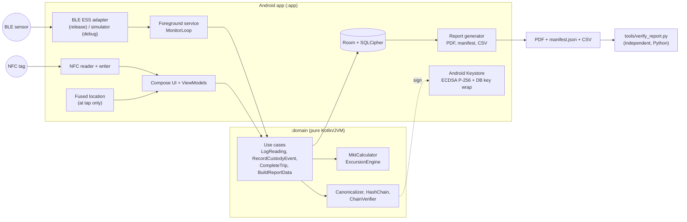
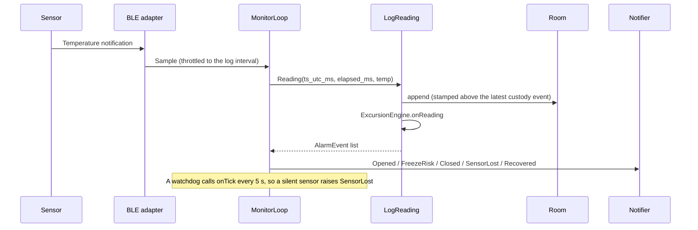
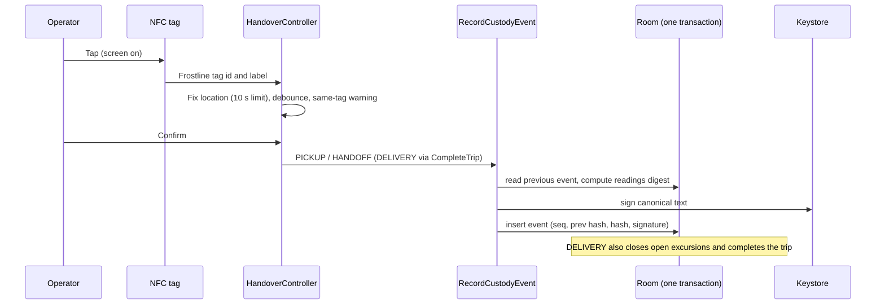

# Frostline

Frostline is a native Android app that helps immunization workers monitor the temperature of vaccine carriers (coolboxes) during last-mile cold chain transport. It reads a cheap open-profile BLE sensor, logs continuously, raises alarms, records NFC handovers between points, and produces a tamper-evident signed report that anyone can verify independently.

> **Disclaimer.** Frostline is an aid and a feasibility study. It is **NOT** a replacement for a WHO PQS-certified data logger and must not be presented as one. It makes no claim of WHO PQS certification, clinical validity or regulatory approval. The default 2 to 8 degC limits are settings, not a clinical standard.

Status: v0.1.0-mvp. All logic is covered by automated tests; behaviour on real BLE, NFC, GPS and phones has **not** been exercised yet (see [Status](#status)).

## The problem

Vaccines lose potency when they get too warm or freeze. In the last mile (health post, outreach session) the carrier is a passive coolbox with ice packs and often no continuous record at all. Without a record nobody can tell whether a vial spent an hour at 12 degC, and nobody can show who held the box when it happened. Frostline aims to make that record cheap (any phone plus a few-dollar BLE sensor), continuous, and hard to alter silently.

Impact it is designed for: earlier warnings (heat, cold, freeze risk, silent sensor), a per-trip summary (mean kinetic temperature and time outside range), and a chain of custody tied to place, time, operator and temperature data. It is a portfolio and feasibility project, not a certified product.

## Features

1. Pair one BLE sensor that exposes the Environmental Sensing Service (`0x181A`): Temperature `0x2A6E`, optional Humidity `0x2A6F`. Sensor-agnostic.
2. Continuous logging in a foreground service (type `connectedDevice`) that survives reconnects and process death.
3. Mean kinetic temperature (MKT), excursion detection (HEAT, COLD, FREEZE) with hysteresis, notifications, and a lost-sensor warning.
4. NFC handover with at least two tags: `PICKUP`, `HANDOFF`, `DELIVERY`, bound to time, location (only at tap, screen on), operator and temperature data, in an append-only signed chain.
5. Local storage in Room on SQLCipher; the signing key (ECDSA P-256) lives in the Android Keystore.
6. One timeline per trip: temperature, excursions and handovers.
7. Signed PDF report, JSON manifest, CSV export, and an independent Python verifier.
8. Sensor simulator in debug builds, so demos and tests need no hardware.
9. A screen that writes Frostline NFC tags, so you can make your own demo tags.

Out of scope by design: web dashboard, cloud sync, geofencing, maps, several sensors at once, accounts, analytics, ads, iOS, other languages. The architecture is sync-ready (UUIDs, UTC timestamps, append-only) but nothing is synced. The UI is Indonesian; code, comments and this README are English.

## Architecture



`:domain` has no Android dependency, so every rule below is unit-tested on the JVM. Hilt wires the modules; Coroutines and Flow carry data; KSP generates Room and Hilt code.

### Temperature data flow



### Custody data flow



## Integrity design

- Every reading stores `ts_utc_ms` (wall clock) and `elapsed_ms` (monotonic). Wall-clock jumps show up as a mismatch between the two and are listed as warnings in the report.
- A reading is canonicalized as the line `ts_utc_ms|temp_centi\n` (`temp_centi = round(temp_c * 100)`). `readings_digest` is the SHA-256 of those lines, ordered by timestamp, for all readings of the trip up to the event time. A reading that arrives stamped at or before the latest custody event is stored one millisecond after it, so an honest chain always verifies.
- A custody event is canonicalized as UTF-8 `key=value` lines in a fixed order: `v, trip, seq, type, tag, tag_label, ts, lat, lon, acc, user, temp_centi, excursion_open, readings_digest, prev` (absent values are `-`, coordinates have 7 decimals, the first `prev` is 64 zeros).
- `hash = SHA-256(canonical)` and `signature = SHA256withECDSA(canonical)` with a non-exportable Keystore key (StrongBox when available, else TEE).
- `custody_events` has no UPDATE or DELETE path in the DAO, and SQLite triggers abort any attempt. New readings or events for a completed trip are also rejected by triggers.
- The report manifest signs a canonical JSON document that includes the hash of the PDF.

## Threat model

Frostline is **tamper-evident, not tamper-proof.**

- Changing any recorded value, the event order, or the exported PDF or CSV is detected by the hash chain, the per-event signatures, and the manifest signature.
- A rooted device can still rewrite the entire chain, and re-sign it with the device key, before export. A manifest signed by an attacker's own key verifies by itself; only a trusted key fingerprint reveals it. Compare the fingerprint with one obtained from the device owner through another channel.
- The signature proves "made by this device key", not who the person is. The operator is an app-local identifier.
- NFC tags can be cloned: the tag identity is an id written into the tag, not a hardware-protected secret.
- The wall clock can be changed by the user. Jumps are detected against the monotonic clock and reported, not prevented.
- If the signing key is lost (for example app data cleared, or a Keystore reset), older chains cannot be re-verified on the device. The manifest keeps the public key that signed it.
- The database passphrase (32 random bytes) is wrapped with an AES-GCM Keystore key. If the key file or wrapping key is lost the app refuses to open the data and never creates a new key over an existing database.
- Data is excluded from backups (`allowBackup=false`, extraction rules exclude database, files and preferences). There is no network permission.

## Build and run

Requirements: JDK 17, Android SDK (`ANDROID_HOME`), Python 3 for the verifier.

```
export JAVA_HOME=/path/to/jdk-17
./gradlew :domain:test :app:testDebugUnitTest :app:lintDebug :app:assembleDebug
./gradlew :app:assembleRelease             # R8 enabled, unsigned APK, no key in the repo
./gradlew :app:connectedDebugAndroidTest   # needs an emulator or phone
```

Release signing is deliberately not configured; supply your own signing config locally and never commit a keystore.

### Run with the simulator (no hardware)

1. Install the debug build (`./gradlew :app:installDebug`) on a phone or emulator (API 26 or newer).
2. Finish onboarding and grant the permissions.
3. Home, "Pilih sensor": choose an entry named "Simulasi: ..." (for example "semua skenario berurutan"). The simulator runs 10 times faster than real time.
4. "Mulai perjalanan", choose or name a coolbox, "Mulai pemantauan".
5. On the "Serah-terima" screen a debug-only button simulates an NFC tap, so you can record `PICKUP`, `HANDOFF` and `DELIVERY` without tags. The simulator and that button do not exist in release builds.

### Make two NFC tags

Use two or three blank NTAG213, NTAG215 or NTAG216 stickers. Open "Tulis Tag", type a name (up to 32 characters, for example "Gudang Dinkes"), tap "Tulis ke tag" and hold the tag to the back of the phone. The app writes a Frostline NDEF URI record with a random id and reads it back to check. Repeat with another name ("Puskesmas A") for the second tag. Anything that is not a Frostline tag is rejected at handover.

### Build the ESP32 test sensor

`tools/esp32-ess-sensor` is an Arduino (NimBLE) sketch that advertises as `Frostline-ESS` with the Environmental Sensing Service: a sine wave from 1 to 9 degC (10 minute period) notified every 10 seconds, so it crosses both limits. See [its README](tools/esp32-ess-sensor/README.md). It has not been tested on hardware.

## Verify a report independently

The verifier shares no code with the app and needs only the `cryptography` package.

```
pip install -r tools/requirements.txt
python3 tools/verify_report.py trip.manifest.json --pdf trip.pdf --readings-csv trip.readings.csv
pytest tools/tests
```

Exit code 0: every check passed. 1: a check failed (for example one changed character). 2: unreadable input. The verifier recomputes every event's canonical text from its fields, hashes, signatures, chain links, the readings digest at each event, the PDF hash and the CSV digest, and prints the signer key fingerprint. The PDF itself is not a PAdES document; the manifest binds it by hash.

## Demo script: coolbox with an ice pack

You need a phone with the debug build, two NFC tags (or the debug tap button), and either the ESP32 sensor or a simulator sensor. For a real coolbox put the sensor inside with a frozen ice pack and a vial-sized water bottle.

| Step | Action | Expected result |
|---|---|---|
| 1 | Write tags "Gudang" and "Puskesmas" (Tulis Tag). | "Berhasil ditulis dan dibaca ulang" for both. |
| 2 | Pick the sensor, start a trip (default limits 2.0 to 8.0 degC, freeze at 0.0, 60 s interval). | Persistent notification; Home shows the last temperature and "DALAM RENTANG" while it is inside the range. |
| 3 | Tap "Gudang", confirm. | `PICKUP` event #1 with temperature, location (or the reason it is empty), tag label. |
| 4 | Put the ice pack next to the sensor. Temperature falls below 2.0 degC for two consecutive readings. | A COLD alarm. A further drop to 0.0 degC or below raises a freeze-risk alarm on the same excursion. |
| 5 | Take the pack out and leave the lid open. Temperature rises above 8.0 degC for two readings. | A HEAT excursion opens (the cold one closes first, because HEAT and COLD are separate records). |
| 6 | Close the lid with the pack. Two readings inside 2.2 to 7.8 degC. | The excursion closes; Home shows time spent outside the range. |
| 7 | Carry the box away from the phone for more than 5 minutes (or turn the sensor off). | One "sensor not sending data" alarm; "recovered" when data returns. |
| 8 | Tap "Puskesmas", confirm. | `HANDOFF` event #2. |
| 9 | Tap "Gudang" again, tick the final destination box, confirm. | `DELIVERY` event #3. Monitoring stops, open excursions are closed at that time, the trip is completed and locked. |
| 10 | Perjalanan, open the trip: timeline and chart; "Buat dan bagikan laporan". | Share sheet with PDF, manifest, two CSV files. The detail screen shows the custody chain as valid. |
| 11 | On a computer run `verify_report.py` on the files. | `RESULT: PASS`, exit code 0, with the key fingerprint. Change one character in the manifest and run again: `RESULT: FAIL`, exit code 1. |

With the simulator, "Simulasi: semua skenario berurutan" runs stable, heat, freeze, dropout and oscillation phases in about 16 minutes of real time.

## Status

Honest status per mandatory item. "Needs device test" means code and tests exist but it was never run against the real hardware. Details and test locations: [docs/PROGRESS.md](docs/PROGRESS.md). The independent audit: [docs/AUDIT.md](docs/AUDIT.md). What the owner must test: [docs/HARDWARE_TEST.md](docs/HARDWARE_TEST.md). Open limits: [docs/BLOCKERS.md](docs/BLOCKERS.md). Release preparation: [docs/PLAY_READINESS.md](docs/PLAY_READINESS.md). Screenshots to take: [docs/screenshots/README.md](docs/screenshots/README.md).

| # | Item | Status |
|---|---|---|
| 1 | BLE pairing (ESS) | Needs device test (parser, backoff, GATT queue, scan UI tested; real GATT not run) |
| 2 | Foreground logging service | Needs device test (simulator and process kill verified earlier on an emulator; real BLE, Doze, OEM kills not) |
| 3 | MKT, excursions, alarms | Verified (unit tests, independent hand calculation); physical sound and vibration not checked |
| 4 | NFC handover and custody chain | Needs device test (logic and chain verified; physical tags and real GPS not) |
| 5 | Room, SQLCipher, Keystore | Verified on an emulator with a software Keystore; StrongBox not checked |
| 6 | Trip timeline | Verified |
| 7 | PDF, manifest, CSV, verifier | Needs device test for the real PDF render and share sheet; manifest, CSV and verifier verified (JVM and pytest) |
| 8 | Sensor simulator (debug) | Verified |
| 9 | NFC tag writer | Needs device test (validation and encoding tested; writing a physical tag not) |

## License and owner

MIT. Copyright (c) 2026 Vassel Goleyu. See [LICENSE](LICENSE).
